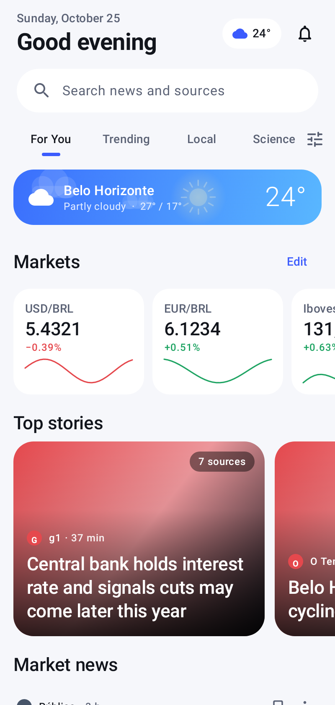
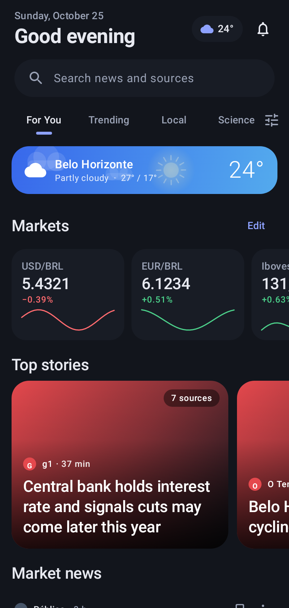
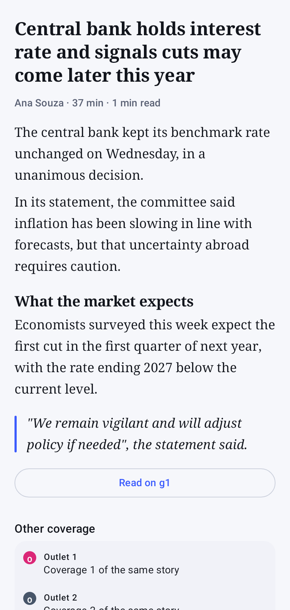
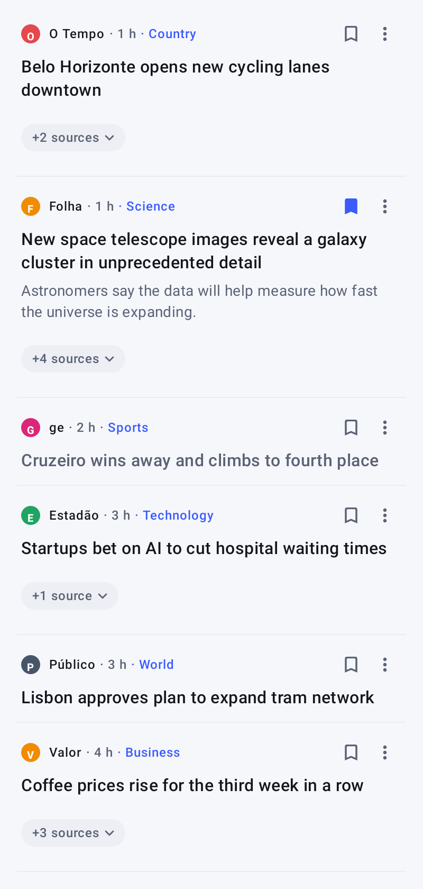
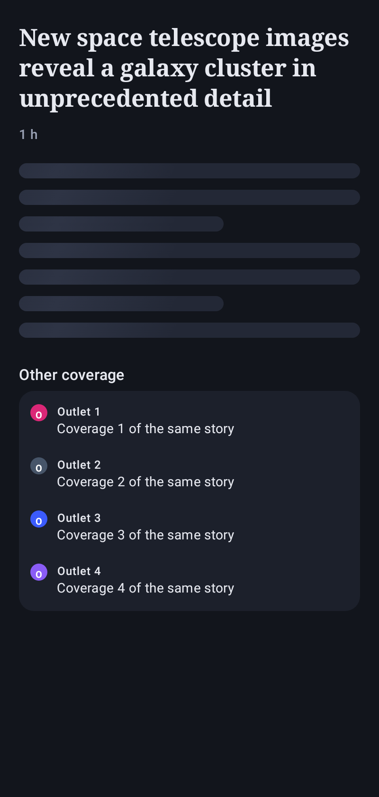
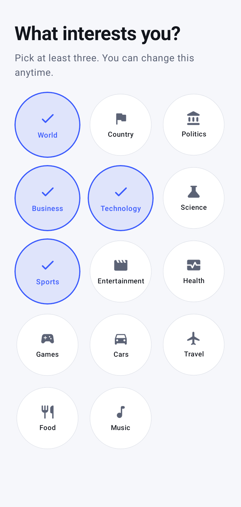
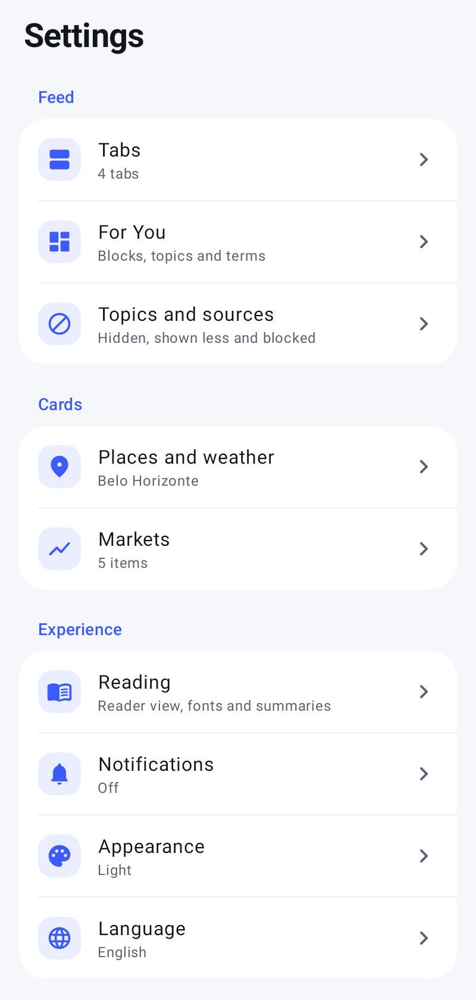

<p align="center">
  
</p>

<h1 align="center">Banca</h1>

<p align="center">
  <b>Your newsstand.</b> A calm, private news reader for Android.<br>
  Google News and publishers' feeds in one personal feed, with weather, currencies and markets.<br>
  No account, no ads, no tracking.
</p>

<p align="center">
  <a href="https://github.com/filipembcruz/banca/releases/latest/download/banca.apk"><b>⬇ Download the latest APK</b></a>
  &nbsp;·&nbsp;
  <a href="README.pt-BR.md">Leia em português</a>
</p>

<p align="center">
  
  
  
</p>

## Features

**Your feed**
- **For You** mixes the topics you pick with what you actually read. Learning happens on the device only.
- **Trending** ranks the stories covered by the most outlets right now.
- **Local** has one feed per place (Belo Horizonte, Lisbon…), switched with chips, in the order you choose.
- **Your own tabs:** any topic, a saved search (with Google News operators such as `site:` or `"exact phrase"`) or any RSS feed.
- Every story shows its main outlet first, with **other coverage** of the same story one tap away.

**Reading**
- **Reader view** with a clean serif layout, a full-bleed picture with parallax, adjustable text size and reading progress.
- The **original page** opens in an in-app browser whenever you prefer.
- **Offline summaries:** the publisher's own summary when the feed has one, otherwise the key sentences of the article. Clickbait phrases are filtered out. No AI service, no API key.
- **Zoomable pictures:** tap any picture, then pinch or double-tap.

**Cards on For You**
- **Weather** for each of your places, compact or expanded, with animated sun, clouds, rain, snow and lightning. Data from Open-Meteo.
- **Markets:** currencies (USD/BRL, EUR/BRL…) and indices (Ibovespa, S&P 500, Euro Stoxx 50…) with sparklines and a detail chart.
- **Market news** for the indices you follow.

**You stay in control**
- Save stories to read later, even offline. Saved stories and history are searchable.
- **Hide** a story, or **show less** about a topic, a name from the headline or an outlet. Every choice can be undone and reverted in Settings.
- **Block** outlets entirely.
- Reorder tabs, places, markets and For You blocks by dragging.
- Pick the news country (Brazil, Portugal or international) and how old stories may be.

**Notifications**
- Rules per topic, term, outlet or place, each with its own delivery (instant or in the digest), style (large picture, compact or headline only) and Android channel.
- **Digests** at the times you choose, optionally with the weather. Tapping one opens an inbox with every story ready to read.
- **Big-story** alerts, quiet hours, a daily limit and battery-friendly background refresh.

**Look and feel**
- Light, dark and pure-black themes, a fixed accent or wallpaper colours (Material You).
- Shared-element transitions, spring animations and a floating navigation bar. Respects "Remove animations".
- English and Brazilian Portuguese.

## More screenshots

<p align="center">
  
  
  
  
</p>

## Install

1. On your phone, download [`banca.apk`](https://github.com/filipembcruz/banca/releases/latest/download/banca.apk) from the latest release.
2. Open it and allow installing from your browser or file manager if Android asks.
3. If Play Protect warns about an unknown app, choose **Install anyway**. Banca only asks for notifications and, if you want, your approximate location.

New versions install over the old one and keep your data. Android 8.0 or newer is required.

## Privacy

Banca has no account, no analytics and no server of its own. Settings, saved stories, history and what the app learns about your interests stay on your phone. The app talks only to the sources it reads from: Google News RSS, the publishers' sites and feeds, Open-Meteo (weather), Yahoo Finance and AwesomeAPI (quotes) and Google's favicon service (outlet icons). You can export and import your settings as a JSON file.

## Data sources

| Data | Source |
| --- | --- |
| Headlines, topics, places, search | [Google News RSS](https://news.google.com) |
| Publisher feeds and pictures | g1, Agência Brasil, Tecnoblog, Olhar Digital and the pages themselves (`og:image`) |
| Weather and place search | [Open-Meteo](https://open-meteo.com) (CC BY 4.0) |
| Currencies and indices | Yahoo Finance chart API (unofficial, about 15 min delay) and [AwesomeAPI](https://docs.awesomeapi.com.br) |

## Build from source

The project is plain Gradle with Kotlin and Jetpack Compose. No wrapper is committed.

```bash
# Gradle 8.11+ and JDK 17, Android SDK 35
gradle assembleDebug
# screenshots of the main screens (Robolectric + Roborazzi), written to app/build/screens
gradle :app:recordRoborazziDebug
```

Every push to `main` runs the [GitHub Actions workflow](.github/workflows/android.yml): it builds, signs and publishes a release with the APK and the screenshots.

**Stack:** Kotlin 2.0 · Jetpack Compose (Material 3) · Navigation Compose · WorkManager · DataStore · SQLite · OkHttp · jsoup · Coil.

## License

[MIT](LICENSE)
